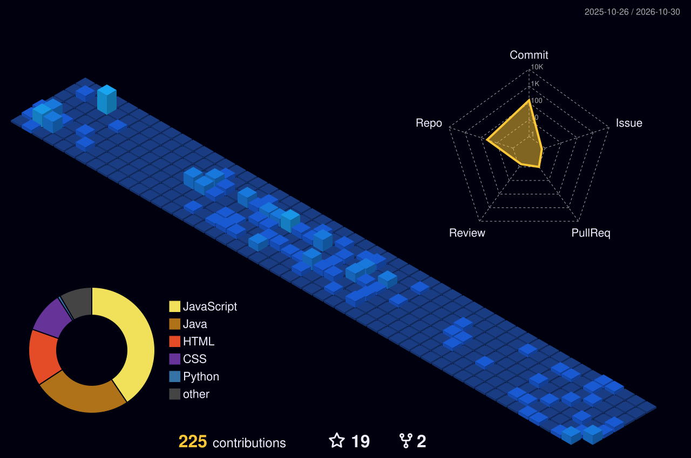

<div align="center">


[](https://www.linkedin.com/in/heitor-perciliano)

</div>

## Sobre mim

```java
public class Heitor {
    String role      = "Desenvolvedor Back-End Java";
    String location  = "São Paulo, Brasil";
    String[] studies = { "Sistemas de Informação — Senac", "Desenvolvimento de Sistemas — SENAI" };
    String[] stack   = { "Java", "Spring Boot", "Spring Security/JWT", "Spring Data JPA", "MySQL", "PostgreSQL" };
    String goal      = "Estágio em Desenvolvimento ou vaga de Desenvolvedor Back-End Júnior";
}
```

Construo APIs REST com Java e Spring Boot, com foco em arquitetura em camadas, segurança com Spring Security/JWT e persistência com JPA. Hoje atuo em Infraestrutura de TI, o que me ajuda a entender o ambiente onde as aplicações rodam.

## Stack

<p>
  
</p>

## Projetos em destaque

| Projeto | Descrição | Stack |
|---|---|---|
| [**E-commerce API**](https://github.com/Heitor-Guimaraes/finallyEcommerce) | API REST com autenticação JWT, perfis `USER`/`ADMIN`, produtos, pedidos, pagamentos e upload de imagens | Java 17 · Spring Boot · Spring Security · JPA · MySQL |
| **Emprega.co** *(privado)* | Plataforma de vagas para a ONG G10 das Favelas, desenvolvida em um time de 5 pessoas | Java 21 · Spring Boot · PostgreSQL · React Native · TypeScript |

## Contribuições


